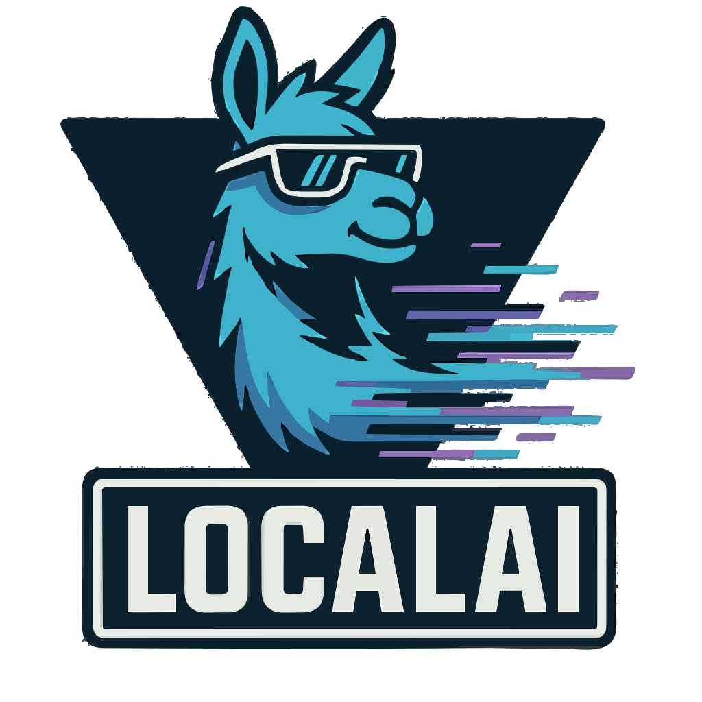

# Freelancing Training On-Demand | School Of Freelancing

## All Training Programs

### [Linux Freelancing Training](/freelancing-training/linux-freelancing-training)

Become an in-demand Linux System Administrator, build a freelance business, and win high-paying global clients.

**Features:**

- 90 Hands-on Training Sessions
- No Pre-Recorded Training Videos
- Live Online, Instructor-led Training
- Guaranteed Minimum Income (GMI* (subject to Training Rules))*
- Credential Verification Support

### [Hermes Agent Training](/freelancing-training/hermes-agent-training)

Build an in-demand freelance career as a Hermes AI Agent Engineer and attract premium global projects.

**Features:**

- 20 Hands-on Training Sessions
- No Pre-Recorded Training Videos
- Live Online, Instructor-led Training
- Guaranteed Minimum Income (GMI* (subject to Training Rules))*
- Credential Verification Support

### [Telnyx SMS API Training](/freelancing-training/telnyx-sms-api-training)

Learn how to develop a bulk SMS system using Telnyx SMS API and attract premium global clients now!

**Features:**

- 30 Hands-on Training Sessions
- No Pre-Recorded Training Videos
- Live Online, Instructor-Led Training
- Guaranteed Minimum Income (GMI* (subject to Training Rules))*
- Credential Verification Support

### [Odysseus AI Training](/freelancing-training/odysseus-ai-training)

Set up Odysseus on Linux, optimize AI synergy, and build service portfolios across marketplaces.

**Features:**

- 20 Hands-on Training Sessions
- No Pre-Recorded Training Videos
- Live Online, Instructor-Led Training
- Service Portfolio Development
- Credential Verification Support

### [OpenClaw Freelancing Training](/freelancing-training/openclaw-training)

Learn to deploy OpenClaw Linux servers for AI agents, build your service portfolio, and get hired freelance.

**Features:**

- 20 Hands-on Training Sessions
- No Pre-Recorded Training Videos
- Live Online, Instructor-Led Training
- Guaranteed Minimum Income (GMI* (subject to Training Rules))*
- Credential Verification Support

### [LocalAI Freelancing Training](/freelancing-training/local-ai-training)

Deploy LocalAI on your own server, run private AI models, and win freelance clients with a proven service portfolio.

**Features:**

- 20 Hands-on Training Sessions
- No Pre-Recorded Training Videos
- Live Online, Instructor-Led Training
- Service Portfolio Development
- Credential Verification Support

### [ZeroClaw Freelancing Training](/freelancing-training/zeroclaw-training)

A hands-on training covering ZeroClaw fundamentals, production deployment, and building a profitable service around it.

**Features:**

- 20 Hands-on Training Sessions
- No Pre-Recorded Training Videos
- Live Online, Instructor-Led Training
- Service Portfolio Development
- Credential Verification Support

### [GitLab Freelancing Training](/freelancing-training/gitlab-training)

Learn GitLab production setup, migration, version control, CI/CD, & project management to secure freelance jobs.

**Features:**

- 20 Hands-on Training Sessions
- No Pre-Recorded Training Videos
- Live Online, Instructor-Led Training
- Guaranteed Minimum Income (GMI* (subject to Training Rules))*
- Credential Verification Support

### [GitHub Freelancing Training](/freelancing-training/github-training)

Learn GitHub Enterprise Server deployment, Actions CI/CD, migration, and building a profitable freelance service.

**Features:**

- 20 Hands-on Training Sessions
- No Pre-Recorded Training Videos
- Live Online, Instructor-Led Training
- Guaranteed Minimum Income (GMI* (subject to Training Rules))*
- Credential Verification Support

### [Docker Freelancing Training](/freelancing-training/docker-training)

Hands-on Docker training covering three production deployments, building a freelance service, and client acquisition.

**Features:**

- 20 Hands-on Training Sessions
- No Pre-Recorded Training Videos
- Live Online, Instructor-Led Training
- Guaranteed Minimum Income (GMI* (subject to Training Rules))*
- Credential Verification Support

### [FusionPBX Freelancing Training](/freelancing-training/fusionpbx-training)

Learn FusionPBX VoIP deployment, advanced configuration, and call routing, then build a profitable freelance service.

**Features:**

- 20 Hands-on Training Sessions
- No Pre-Recorded Training Videos
- Live Online, Instructor-Led Training
- Guaranteed Minimum Income (GMI* (subject to Training Rules))*
- Credential Verification Support

### [GOautodial Freelancing Training](/freelancing-training/goautodial-training)

Learn GOautodial Freelancing Training for VoIP setup, call testing, freelance portfolio creation, and landing clients.

**Features:**

- 20 Hands-on Training Sessions
- No Pre-Recorded Training Videos
- Live Online, Instructor-Led Training
- Guaranteed Minimum Income (GMI* (subject to Training Rules))*
- Credential Verification Support

### [Call Center Freelancing Training](/freelancing-training/call-center-setup-training)

Learn enterprise call center setup, for SIP trunking, IVR, predictive dialers, and CRM integration, to work as a freelancer.

**Features:**

- 20 Hands-on Training Sessions
- No Pre-Recorded Training Videos
- Live Online, Instructor-Led Training
- Guaranteed Minimum Income (GMI* (subject to Training Rules))*
- Credential Verification Support

### [Ubuntu Linux Freelancing Training](/freelancing-training/ubuntu-linux-training)

Learn Ubuntu Linux: setup web servers, CRMs & harden security. Build a portfolio for freelance clients for Ubuntu support.

**Features:**

- 20 Hands-on Training Sessions
- No Pre-Recorded Training Videos
- Live Online, Instructor-Led Training
- Guaranteed Minimum Income (GMI* (subject to Training Rules))*
- Credential Verification Support

### [Debian Linux Freelancing Training](/freelancing-training/debian-linux-training)

Learn Debian Linux admin: Set up LEMP, deploy Vtiger/Odoo/Attendize, fix errors, build portfolio & land clients.

**Features:**

- 20 Hands-on Training Sessions
- No Pre-Recorded Training Videos
- Live Online, Instructor-Led Training
- Guaranteed Minimum Income (GMI* (subject to Training Rules))*
- Credential Verification Support

### [CentOS Linux Freelancing Training](/freelancing-training/centos-linux-training)

Learn CentOS Linux admin — set up LEMP stacks, deploy Django, Hadoop, MEAN, Next.js, troubleshoot, and land clients.

**Features:**

- 20 Hands-on Training Sessions
- No Pre-Recorded Training Videos
- Live Online, Instructor-Led Training
- Guaranteed Minimum Income (GMI* (subject to Training Rules))*
- Credential Verification Support

### [OpenAI Freelancing Training](/freelancing-training/openai-training)

OpenAI Developer Training: Build real-world AI applications, then find and apply for freelance jobs on Upwork.

**Features:**

- 20 Hands-on Training Sessions
- No Pre-Recorded Training Videos
- Live Online, Instructor-Led Training
- Guaranteed Minimum Income (GMI* (subject to Training Rules))*
- Credential Verification Support

### [Claude Freelancing Training](/freelancing-training/claude-training)

Learn Claude API & AI agent engineering — prompt engineering, tool use, RAG, agent orchestration. Land freelance clients.

**Features:**

- 20 Hands-on Training Sessions
- No Pre-Recorded Training Videos
- Live Online, Instructor-Led Training
- Guaranteed Minimum Income (GMI* (subject to Training Rules))*
- Credential Verification Support

### [Twilio SMS API Freelancing Training](/freelancing-training/twilio-sms-api-training)

Learn Twilio SMS API setup, integration, automation, troubleshooting, and real-world freelancing skills.

**Features:**

- 30 Hands-on Training Sessions
- No Pre-Recorded Training Videos
- Live Online, Instructor-Led Training
- Guaranteed Minimum Income (GMI* (subject to Training Rules))*
- Credential Verification Support

### [Jasmin SMS Gateway Freelancing Training](/freelancing-training/jasmin-sms-gateway-training)

Learn Jasmin SMS Gateway — deploy bulk SMS on Ubuntu, integrate SMPP/HTTP APIs, troubleshoot, land freelance clients.

**Features:**

- 20 Hands-on Training Sessions
- No Pre-Recorded Training Videos
- Live Online, Instructor-Led Training
- Guaranteed Minimum Income (GMI* (subject to Training Rules))*
- Credential Verification Support

### [Bulk SMS Freelancing Training](/freelancing-training/bulk-sms-setup-training)

Build bulk SMS systems with SMS APIs — automate CSV messaging, deploy production workflows, land freelance clients.

**Features:**

- 20 Hands-on Training Sessions
- No Pre-Recorded Training Videos
- Live Online, Instructor-Led Training
- Guaranteed Minimum Income (GMI* (subject to Training Rules))*
- Credential Verification Support

## Overview

Join Freelancing Training On-Demand at School Of Freelancing. Book live 1-on-1 hands-on sessions in Linux, AI, and VoIP scheduled on your request.

## Frequently Asked Questions

### How does Freelancing Training On-Demand work?
Freelancing Training On-Demand lets you book live, 1-on-1 or small-group Instructor-Led Training (ILT) sessions in Linux, AI agents, and VoIP scheduled directly around your availability—with zero pre-recorded videos.

### What is Guaranteed Minimum Income (GMI* (subject to Training Rules)) for training programs?
Guaranteed Minimum Income (GMI* (subject to Training Rules)) ensures eligible trainees earn a minimum income after completing their program, provided they attend all live sessions regularly without dropping out and purchase the required marketplace bids or connects to apply for client jobs.

### What kind of portfolio projects and credential verification do trainees receive?
Trainees exclusively build functional, secure, production-ready Free and Open-Source Software (FOSS) projects on GitHub, and receive Credential Verification Support where School Of Freelancing directly confirms their skills to inquiring global clients.

### How are training prices and session schedules determined?
Training fees and durations are scaled transparently in USD based on technical complexity, instructional hours, and global market demand, with full payment required upfront prior to enrollment to reserve dedicated live mentor sessions.

## Global & US Availability

Our live training sessions serve learners worldwide, with dedicated scheduling and support tailored for clients in the United States ([US Location Hub](https://schooloffreelancing.com/locations/en-us)).

## Compare All 21 Live Training Programs

| Training Program | Domain Track | Core Technologies | Production Portfolio Outcome |
| :--- | :--- | :--- | :--- |
| [Linux Freelancing Training](https://schooloffreelancing.com/freelancing-training/linux-freelancing-training) | Enterprise Linux | RHEL/Ubuntu, SSH, Firewalls, LAMP/LEMP | Production Linux Server & Hardening Portfolio |
| [Hermes Agent Training](https://schooloffreelancing.com/freelancing-training/hermes-agent-training) | AI Agents & LLMs | Hermes Agent Framework, Tool Use, Linux | Autonomous AI Agent Deployment |
| [Telnyx SMS API Training](https://schooloffreelancing.com/freelancing-training/telnyx-sms-api-training) | Telecom & SMS APIs | Telnyx REST API, Webhooks, 10DLC | Automated Bulk SMS & Webhook App |
| [Odysseus AI Training](https://schooloffreelancing.com/freelancing-training/odysseus-ai-training) | AI Agents & LLMs | Odysseus AI, Linux Orchestration, LLMs | Custom AI Workflow & Server Integration |
| [OpenClaw Freelancing Training](https://schooloffreelancing.com/freelancing-training/openclaw-training) | AI Agents & LLMs | OpenClaw, Linux Agent Hosting, APIs | Self-Hosted AI Agent Server |
| [LocalAI Freelancing Training](https://schooloffreelancing.com/freelancing-training/local-ai-training) | AI Agents & LLMs | LocalAI, GGUF Models, Docker, OpenAI API | Private On-Premise LLM Inference Server |
| [ZeroClaw Freelancing Training](https://schooloffreelancing.com/freelancing-training/zeroclaw-training) | AI Agents & LLMs | ZeroClaw Runtime, Linux Deployment | Production ZeroClaw Agent Service |
| [GitLab Freelancing Training](https://schooloffreelancing.com/freelancing-training/gitlab-training) | DevOps & CI/CD | Self-Hosted GitLab, Runners, CI/CD, Backup | Enterprise GitLab & DevSecOps Pipeline |
| [GitHub Freelancing Training](https://schooloffreelancing.com/freelancing-training/github-training) | DevOps & CI/CD | GitHub Enterprise, Actions CI/CD, Migration | Automated GitHub CI/CD & Repo Migration |
| [Docker Freelancing Training](https://schooloffreelancing.com/freelancing-training/docker-training) | DevOps & CI/CD | Docker Engine, Compose, Reverse Proxy, SSL | 3 Multi-Container Production Deployments |
| [FusionPBX Freelancing Training](https://schooloffreelancing.com/freelancing-training/fusionpbx-training) | VoIP & Call Center | FusionPBX, FreeSWITCH, SIP Trunks, IVR | Multi-Tenant Cloud PBX System |
| [GOautodial Freelancing Training](https://schooloffreelancing.com/freelancing-training/goautodial-training) | VoIP & Call Center | GOautodial, Asterisk, VICIdial, SIP | Outbound/Inbound Predictive Dialer Server |
| [Call Center Freelancing Training](https://schooloffreelancing.com/freelancing-training/call-center-setup-training) | VoIP & Call Center | SIP Trunking, IVR, Predictive Dialer, CRM | End-to-End Enterprise Call Center |
| [Ubuntu Linux Freelancing Training](https://schooloffreelancing.com/freelancing-training/ubuntu-linux-training) | Enterprise Linux | Ubuntu LTS, Nginx/Apache, CRM, UFW | Hardened Ubuntu Web & CRM Server |
| [Debian Linux Freelancing Training](https://schooloffreelancing.com/freelancing-training/debian-linux-training) | Enterprise Linux | Debian, LEMP, Vtiger CRM, Odoo ERP | Production ERP/CRM Hosting Stack |
| [CentOS Linux Freelancing Training](https://schooloffreelancing.com/freelancing-training/centos-linux-training) | Enterprise Linux | CentOS/RHEL, LEMP, Django, Next.js, MEAN | Full-Stack Enterprise App Deployment |
| [OpenAI Freelancing Training](https://schooloffreelancing.com/freelancing-training/openai-training) | AI Agents & LLMs | OpenAI API, RAG, Function Calling, Agents | Production RAG & AI Assistant App |
| [Claude Freelancing Training](https://schooloffreelancing.com/freelancing-training/claude-training) | AI Agents & LLMs | Anthropic Claude API, MCP, Tool Use, RAG | Claude AI Agent & Workflow Automation |
| [Twilio SMS API Freelancing Training](https://schooloffreelancing.com/freelancing-training/twilio-sms-api-training) | Telecom & SMS APIs | Twilio Messaging API, TwiML, Webhooks | Two-Way Automated SMS Platform |
| [Jasmin SMS Gateway Freelancing Training](https://schooloffreelancing.com/freelancing-training/jasmin-sms-gateway-training) | Telecom & SMS APIs | Jasmin SMS, SMPP, HTTP API, Ubuntu | Carrier-Grade SMPP Bulk SMS Gateway |
| [Bulk SMS Freelancing Training](https://schooloffreelancing.com/freelancing-training/bulk-sms-setup-training) | Telecom & SMS APIs | SMS APIs, CSV Automation, Queue Workers | High-Throughput Bulk SMS System |
